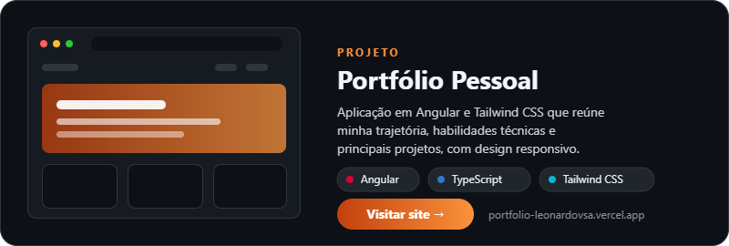
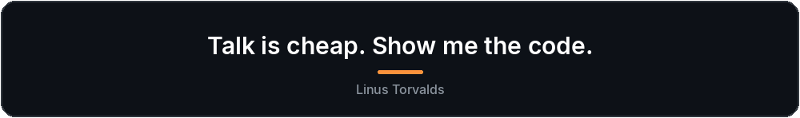

 

## SKILLS

  
    
  

    

  
    
  

    

  
    
  

    

  
    
  

## PROJETOS EM DESTAQUE

  

<!-- Para adicionar mais projetos, crie outro card em assets/ no mesmo formato do project-portfolio.png e coloque ao lado, com width="30%" cada (3 por linha). -->

 

## GITHUB STATS

  <picture>
    <source media="(prefers-color-scheme: dark)" srcset="https://github-profile-summary-cards.vercel.app/api/cards/stats?username=leonardovsa08&theme=github_dark">
    <source media="(prefers-color-scheme: light)" srcset="https://github-profile-summary-cards.vercel.app/api/cards/stats?username=leonardovsa08&theme=github">
    
  </picture>
  &nbsp;
  <picture>
    <source media="(prefers-color-scheme: dark)" srcset="https://github-profile-summary-cards.vercel.app/api/cards/repos-per-language?username=leonardovsa08&theme=github_dark">
    <source media="(prefers-color-scheme: light)" srcset="https://github-profile-summary-cards.vercel.app/api/cards/repos-per-language?username=leonardovsa08&theme=github">
    
  </picture>

## CONTRIBUTION SNAKE

  <picture>
    <source media="(prefers-color-scheme: dark)" srcset="https://raw.githubusercontent.com/leonardovsa08/leonardovsa08/output/github-snake-dark.svg">
    <source media="(prefers-color-scheme: light)" srcset="https://raw.githubusercontent.com/leonardovsa08/leonardovsa08/output/github-snake.svg">
    
  </picture>

  

  

## CONTATOS

  <h4>Se quiser conversar sobre projetos, trocar ideias ou conhecer possíveis oportunidades, fique à vontade para entrar em contato.</h4>
   
  
  &nbsp;&nbsp;
  
  &nbsp;&nbsp;
  
  &nbsp;&nbsp;
  

