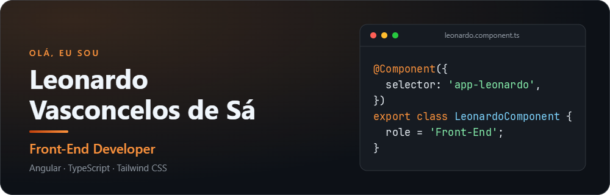
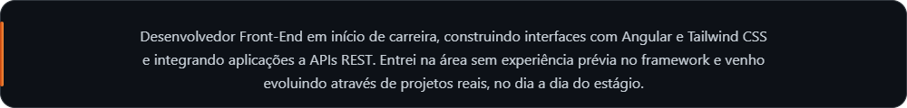
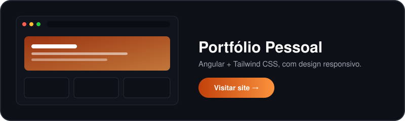

 

## SKILLS

<table align="center" width="100%">
  <tr>
    <td align="center" width="50%" valign="middle">
      <b>Front-End</b> 
      
    </td>
    <td align="center" width="50%" valign="middle">
      <b>Back-End (em estudo)</b> 
      
    </td>
  </tr>
  <tr>
    <td align="center" width="50%" valign="middle">
      <b>Banco de Dados</b> 
      
    </td>
    <td align="center" width="50%" valign="middle">
      <b>Design e Ferramentas</b> 
      
      
    </td>
  </tr>
</table>

## PROJETOS EM DESTAQUE

  

<!-- Para adicionar mais projetos, crie outro card em assets/ no mesmo formato do project-portfolio.svg e coloque ao lado, com width="30%" cada (3 por linha). -->

## GITHUB STATS

  <picture>
    <source media="(prefers-color-scheme: dark)" srcset="https://github-profile-summary-cards.vercel.app/api/cards/stats?username=leonardovsa08&theme=github_dark">
    <source media="(prefers-color-scheme: light)" srcset="https://github-profile-summary-cards.vercel.app/api/cards/stats?username=leonardovsa08&theme=github">
    
  </picture>
  &nbsp;
  <picture>
    <source media="(prefers-color-scheme: dark)" srcset="https://github-profile-summary-cards.vercel.app/api/cards/repos-per-language?username=leonardovsa08&theme=github_dark">
    <source media="(prefers-color-scheme: light)" srcset="https://github-profile-summary-cards.vercel.app/api/cards/repos-per-language?username=leonardovsa08&theme=github">
    
  </picture>

## CONTRIBUTION SNAKE

  <picture>
    <source media="(prefers-color-scheme: dark)" srcset="https://raw.githubusercontent.com/leonardovsa08/leonardovsa08/output/github-snake-dark.svg">
    <source media="(prefers-color-scheme: light)" srcset="https://raw.githubusercontent.com/leonardovsa08/leonardovsa08/output/github-snake.svg">
    
  </picture>

## CONTATOS

  <h4>Se quiser conversar sobre projetos, trocar ideias ou conhecer possíveis oportunidades, fique à vontade para entrar em contato.</h4>
   
  
  &nbsp;&nbsp;
  
  &nbsp;&nbsp;
  
  &nbsp;&nbsp;
  

